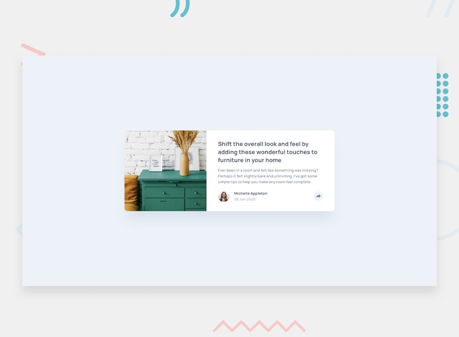

# Frontend Mentor - Article preview component



## Table of contents

- [Overview](#overview)
  - [The challenge](#the-challenge)
  - [Links](#links)
- [My process](#my-process)
  - [Built with](#built-with)
  - [What I learned](#what-i-learned)
- [Author](#author)

## Overview

### The challenge

Your challenge is to build out this article preview component and get it looking as close to the design as possible.

You can use any tools you like to help you complete the challenge. So if you've got something you'd like to practice, feel free to give it a go.

Your users should be able to:

- View the optimal layout for the component depending on their device's screen size
- See the social media share links when they click the share icon
- See hover states for interactive elements

### Links

- Live Site URL: [github pages](https://GerardoCianciulli.github.io/article-preview-component/)

## My process

### Built with

- Semantic HTML5 markup
- CSS custom properties
- CSS Grid
- Desktop-first workflow
- Media Queries
- React
- Typescript
- Vite
- vite-plugin-svgr

### What I learned

I learned how to import SVG files as React components with `vite-plugin-svgr` and pass them as props with Typescript. One `SocialLink` component renders the Facebook, Twitter and Pinterest links, and each link gets its icon through the `icon` prop.

```tsx
import type { ComponentType, SVGProps } from 'react'

type SocialLinkProps = {
  label: string
  href: string
  icon: ComponentType<SVGProps<SVGSVGElement>>
}

const SocialLink = ({ label, href, icon: Icon }: SocialLinkProps) => {
  return (
    <a href={href} aria-label={label}>
      <Icon aria-hidden="true" />
    </a>
  )
}
```

Because the share icon is now an inline SVG instead of an ``, I could recolor it with CSS for the hover state. The SVG has a hard-coded fill, so I set the path to `currentColor` and change the button's `color` on hover:

```css
.share__icon path {
  fill: currentColor;
}

.share__button:hover,
.share__button[aria-expanded='true'] {
  background-color: var(--color-desaturated-dark-blue);
  color: var(--color-white);
}
```

The same share menu has two layouts. On desktop it's a tooltip above the button. On mobile it's a bar across the bottom of the card. I didn't need two components. A media query changes which element the menu is positioned against: switching the wrapper to `position: static` makes the absolutely positioned menu use the card as its reference instead of the button.

```css
@media (max-width: 767px) {
  .share {
    position: static;
  }

  .share__menu {
    right: 0;
    bottom: 0;
    left: 0;
    height: 76px;
  }
}
```

I also learned a CSS Grid sizing gotcha. With `width: 327px; max-width: 100%`, the card still overflowed on a 320px screen because the grid track sized itself to the card's fixed width. Using `width: 100%` with a different `max-width` at each breakpoint let the card shrink:

```css
.card {
  display: grid;
  grid-template-columns: 285px 1fr;
  width: 100%;
  max-width: 730px;
}
```

## Author

- Portfolio - [Gerardo Cianciulli](https://www.behance.net/gerardo-cianciulli)
- Frontend Mentor - [Gerardo Cianciulli](https://www.frontendmentor.io/profile/GerardoCianciulli)
- Linkedin - [Gerardo Cianciulli](https://www.linkedin.com/in/gerardo-cianciulli/)
